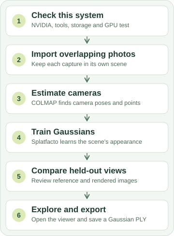

# Photo to Splat

**Your photos. Another dimension.** A local, guided studio for creating Gaussian
splatting reconstructions from overlapping photographs.

Watch an [example reconstruction](frontend/public/demo.mp4), check your computer,
import a capture, and let the application connect the reconstruction tools. Keep
separate scenes and repeat experiments without replacing earlier runs.



## What this project creates

The result is an **appearance representation** you can explore from nearby new
viewpoints. It is not a watertight CAD mesh, a guarantee of physical dimensions,
or reliable geometry for surfaces never photographed.

- A React/TypeScript studio served locally by FastAPI, with a prerecorded orbit
  of an actual trained synthetic Gaussian scene on the welcome screen.
- Readiness checks for NVIDIA graphics, execution platform, tools, and storage.
- An explicit GPU render **and backward-pass** test. Finding a GPU alone does
  not mark the computer verified.
- Folder or individual-photo import, orientation correction, thumbnails,
  content deduplication, and stable copies of accepted originals.
- Independent scenes and run snapshots, one active reconstruction, stage logs,
  checkpoint recovery, integrity checks, comparisons, and Gaussian PLY export.

## Can my system run it?

The studio supports compatible desktop and portable systems. Its dashboard starts
without the GPU stack and explains missing requirements. Reconstruction needs:

| Requirement | Supported configuration |
|---|---|
| Operating system | Windows x86_64 with WSL2 Ubuntu 24.04+, or compatible Linux x86_64 with glibc 2.39+ |
| Graphics | NVIDIA CUDA GPU with a driver compatible with the pinned runtimes |
| Python | uv selects Python 3.11–3.13 for the app; training uses a separate pinned Python 3.11 environment |
| GPU memory | Depends on the scene; no minimum VRAM cutoff has been established |
| System memory | Plan for 16–32 GB RAM; larger captures may need more |
| Storage | Allow roughly 15–30 GB for tools/caches, plus imported photos and per-run working data/results |
| Internet | Required for initial tools and first-use metric downloads; photos stay local |

The tested system has **24 GB of GPU memory**. See the
[verification record](docs/verification.md) for its exact GPU model, checks,
and known limitations.

RAM figures are planning targets, not tested minimum guarantees. We have not
established a minimum-VRAM cutoff. Resolution, photo count, Gaussian growth, and
other GPU programs affect memory use. Start small and run the execution test.

The training profile pins **PyTorch 2.7.1 + CUDA 12.8**, **Nerfstudio 1.1.5**,
**gsplat 1.4.0**, and GPU-enabled **COLMAP 3.13.0 / CUDA 12.9**. The NVIDIA driver
must support the selected runtimes, including COLMAP's 12.9 build. Use your
vendor-supported driver. `nvidia-smi` reports driver CUDA capability, not proof
that the development toolkit is installed.

AMD, Intel integrated GPUs, Apple Silicon, CPU-only Gaussian training, native
Windows GPU training without WSL, multi-GPU execution, and managed cloud jobs
are outside the first release's supported training route. The UI can explain
compatibility but cannot turn an unsupported device into a CUDA GPU.

## First launch: no code to edit

### Windows

1. Install [uv](https://docs.astral.sh/uv/getting-started/installation/). Reopen
   PowerShell afterward so it is on PATH.
2. Download/extract or clone this repository. Open its folder in VS Code.
3. Open **Terminal → New Terminal**, choose **PowerShell**, and run from the root:

   ```powershell
   uv sync --locked --no-dev
   uv run --locked --no-dev photosplat ui
   ```

   `./start.ps1` runs these commands too. If script execution is blocked, use the
   commands directly rather than changing system execution policies.
4. Open **http://localhost:8765** if the browser does not open automatically.
   Keep the terminal running. Closing a browser tab does not cancel a job;
   stopping the app interrupts its worker at the latest saved stage/checkpoint.

For training, install [WSL2 Ubuntu](https://learn.microsoft.com/windows/wsl/install)
and confirm `wsl -d Ubuntu -- nvidia-smi` sees your GPU. The application does not
install WSL, elevate privileges, or replace the NVIDIA driver for you. The app
can run in Windows Python and invoke GPU tools inside WSL.

### Linux

Install uv and use the same two commands, or run `bash start.sh`. The supplied
training profile requires Linux x86_64, glibc 2.39+, and a working NVIDIA driver.
Ubuntu 24.04+ is the target; Ubuntu 26.04 under WSL2 is the exercised route.
Other distributions need compatible native libraries.

**Success looks like:** the studio opens with an example orbit and readiness
cards. Missing tools produce **Setup needed**, not a demand to edit Python.

## Set up reconstruction tools

Open **Computer & setup**. The app detects existing tools first. If components
are missing, review the location and storage allowance, then choose **Install
missing tools**. Installed components are reused. If tools are already present,
go straight to GPU verification or your scenes. Native tools and Python packages
are isolated:

```text
System (you manage)
  NVIDIA driver; WSL2 on Windows
Repository .venv (uv)
  FastAPI, image import, CLI, queue, frontend hosting
Linux ~/.local/share/photo-to-splat/
  native/   CUDA 12.8 toolkit, compatible compiler, native runtime libraries
  sfm/      COLMAP and its native dependencies
  train/    uv-locked Python 3.11, PyTorch, Nerfstudio, gsplat
  mamba/    native-package cache
```

Plan for roughly **15–30 GB for tools/download caches**, in addition to scene
data. This is an allowance, not an exact download size. On Windows, Linux tools
usually occupy the WSL virtual disk, possibly on a different volume from photos.

The dashboard does not depend on torch. Micromamba isolates native tools; uv owns
Python packages. A virtual environment and a PyTorch CUDA wheel do not supply
the system driver. A separate toolkit/compiler is needed for gsplat extensions.

Existing compatible environments can be entered as Linux **prefix directories**
under **Use your own environments**. Leave fields blank for managed setup; do
not enter Windows `.venv` paths or paths to individual executables.

After setup, choose **Verify GPU execution**. First execution can compile kernels
and take several minutes. Success means a real Gaussian image was rendered and
differentiated on the GPU. The native bootstrap can also be run inside Linux:

```bash
bash src/photosplat/setup-runtime.sh
```

See [setup details](docs/setup.md) for environment boundaries and diagnosis.

Returning users do not need to install tools for each scene. A successful GPU
test is saved with its date and environment fingerprint. Startup and **Recheck
tools** reuse it when the detected environment matches; changed tools, runtime
paths, GPU/driver, or bundled profile require verification again. A failed retest
replaces the previous success. This records a past execution test, rather than
claiming every future GPU operation will succeed.

**Advanced / maintenance** contains custom runtime settings, logs, and an
explicit **Repair managed tools** flow. Repair may download packages; it reuses
existing native environments and synchronizes the locked Python profile. Custom
environment paths are never silently replaced by managed setup. Storage warnings
lead to workspace storage, rather than suggesting reinstallation.

## Make your first scene

1. Choose **New scene** and give this capture a name.
2. Choose **Select photo folder**, or select individual photos of the same scene.
   Files are transferred to the local backend and copied into the workspace;
   no cloud upload is involved. Keep unrelated scenes separate.
3. Review thumbnails and import errors. Uncheck photos to exclude them from the
   next run. This does not delete photos or change older runs.
4. Start with **Quick preview**. Longer runs may refine detail, but cannot repair
   missing coverage or make an inconsistent capture physically consistent.
5. Keep the app terminal running. Inspect the current stage and its real logs.
   Stop/resume preserves completed stages and the latest saved checkpoint.
6. Compare held-out reference/render pairs, then start the interactive viewer.
   It uses a clear **1600 px** preview by default and takes a few seconds to load.
7. Export the Gaussian PLY and manifest. Reopen the scene later or make a new run.

### Photo guidance

Around 80–200 sharp, overlapping photographs of a stationary object or small
scene are a useful starting point. The 12-photo guardrail is not a quality
promise. Move the camera, keep the object still, and cover several heights. Use
one lens/zoom setting and soft consistent lighting. Missing undersides remain uncertain.

JPEG, PNG, TIFF, and WebP are accepted. Convert HEIC/RAW first. Images above 80 MP
or files above 50 MB are rejected with an explanation. Phone 12 MP captures are
a practical start. Orientation is applied before resizing; alpha is preserved
when present in PNG working copies.

Glass, mirrors, polished metal, moving people, phone shadows, featureless
surfaces, severe blur, and exposure changes are harder. Photo count alone does
not guarantee matching or accurate geometry.

## Scenes, runs, and recovery

- A **scene** holds imported originals and thumbnails.
- A **run** snapshots its photo selection, hashes, settings, seed, and runtime.
- **Resume** validates unchanged inputs/artifacts and recorded training versions
  before continuing an interrupted/failed run.
- **New run** is for different settings or photo selections. Earlier results stay intact.

### Navigate and manage your collection

**Workspace** in the breadcrumb opens Overview. **My scenes** opens the collection;
a scene name on a run page returns to that scene. Browser Back/Forward and refresh
keep the current scene or run URL. You can bookmark those local URLs; they refer
to this computer and its selected workspace.

Every scene card has **Rename** and **Delete** controls, also available inside the
scene. Delete asks for confirmation and moves the scene to **Trash**. **Undo** or
**Restore** returns its imported photos, run history, and results. Trash retains
files and still uses disk space.

Open **My scenes → Trash** to free that space. Choose **Delete permanently** for
one scene, or **Empty Trash** for the current collection. Review the scene names
and type **DELETE** in the confirmation dialog. Permanent deletion removes those
scenes' imported copies, run history, checkpoints, renders, and exports from the
workspace. **It cannot be undone.** Source photos outside the managed scene/run
folders are left alone. New scenes added to Trash after opening the dialog are
not included in that confirmation. If a file is in use, close it and choose
**Retry deletion**; a partially removed scene cannot be restored.

Active runs and open managed viewers must stop before their own scene can be
deleted. A viewer for another scene can stay open while cleaning Trash. See
[Trash and storage](docs/trash.md) for scope and recovery details.

Search and sort help find a scene. Photo exclusions and working settings are
kept as a draft for the current browser tab, including refresh; saved runs remain
the durable record. Photo imports continue when navigating within the app.
Keep the browser tab and app terminal open until import finishes. Closing or
refreshing during import can interrupt the remaining batches; accepted photos
stay imported and repeated files are deduplicated on retry.

See the [interaction checklist](docs/usability.md) for covered flows and limits.

Only one reconstruction can be queued or running in a workspace. Start and Resume
stay disabled until it finishes or stops; **View active run** takes you to its
progress and stop controls. The backend rejects conflicting requests too,
including simultaneous requests from multiple tabs or app instances sharing that
workspace. Failed, interrupted and completed runs remain in history.

Viewers, GPU verification and tool installation use a shared workspace compute
lock. Runtime/workspace changes wait until that work ends. Existing jobs queued
by an older version are preserved and still run sequentially. Separate workspaces
have separate locks; do not run multiple workspaces against the same GPU at once.
See [action coordination](docs/concurrency.md) for the policy and its limits.

```text
workspace/
  scenes/<scene-id>/
    originals/            Stable imported copies
    thumbs/               Browser previews
    record.json           Photo inventory
  runs/<run-id>/
    record.json           Input/settings snapshot and current status
    gpu-verification.json Actual runtime and GPU check
    commands.json         Executed argument lists
    dataset/              Prepared images, cameras, sparse points, COLMAP database
    camera-report.json    Registration and reprojection statistics
    outputs/              Training configuration and latest checkpoint
    renders/              Held-out comparisons
    metrics.json          Whole-image similarity scores
    export/splat.ply      Gaussian representation
    logs/                 Stage output
```

## Settings and larger collections

| Control | Default | Effect |
|---|---|---|
| Quick preview | 7,000 steps | Short first experiment |
| Detailed run | 30,000 steps | Larger optimization budget |
| Working image edge | 1,600 px | Lower values reduce work/memory; originals are unchanged |
| Matching | Exhaustive | All image pairs for small collections |
| Camera calibration | Auto | Share when dimensions and focal metadata agree |
| Registration gate | 70%, at least 12 views | Stop weak camera models before training |
| Seed | 42 | Record random initialization choices |

Exhaustive matching has quadratic cost. Above 500 selected photos the app requires
sequential matching with capture-ordered filenames. This release does not offer
vocabulary-tree retrieval, distributed matching, or unlimited-scale processing.
Mixed cameras/lenses can require explicit per-image calibration or further grouping.

The [pipeline walkthrough](docs/pipeline.md) maps each setting to actual code and
artifacts. [Troubleshooting](docs/troubleshooting.md) covers failed and poor runs.

## CLI for repeatable work

CLI and UI share the Store, Runtime, and Pipeline classes. With a configured runtime:

```bash
uv run --locked photosplat --workspace ./workspaces/studio doctor --verify
uv run --locked photosplat --workspace ./workspaces/studio run --photos /path/to/photos --name "My scene"
uv run --locked photosplat --workspace ./workspaces/studio list
uv run --locked photosplat --workspace ./workspaces/studio resume RUN_ID
uv run --locked photosplat --workspace ./workspaces/studio view RUN_ID
```

`--workspace` goes before the command. Without it the app uses `~/PhotoToSplat`.
The Storage screen can switch workspace locations without moving/deleting old data.
For the foreground CLI viewer, close the UI for that workspace first; its worker
lock prevents training from starting while the viewer uses the GPU. If the UI
is open, use **Start 3D viewer** on the saved result screen instead.
The CLI's explicit GPU test also respects this lock; use the dashboard's
verification button while the UI is running.

## Development and verification

Users run the bundled frontend. Developers need Node.js and pnpm to modify it.
Exact dependencies are in `uv.lock`, `src/photosplat/gpu/uv.lock`, and the pnpm lock.

```bash
uv sync --locked
uv run pytest
cd frontend
pnpm install --frozen-lockfile
pnpm test
pnpm run build
```

The frontend builds into `src/photosplat/web`, packaged with the Python app.
Development can use `pnpm dev` with a backend on 8765. Normal use needs only the
FastAPI process. Tests cover data integrity, concurrent imports, orientation,
immutable selections, tampering, tool-help parsing, API guards, and recovery.
CPU CI cannot prove GPU compatibility: see [verification evidence](docs/verification.md).

## Scope, privacy, and reproducibility

This is an orchestration project, not a new reconstruction algorithm. COLMAP
estimates cameras; Splatfacto trains using gsplat. Reproducibility means locked
dependencies, recorded inputs/settings, and an inspectable procedure. Exact pixels
can differ across hardware, drivers, compilers, and nondeterministic GPU operations.

The Linux native and COLMAP builds have hashed explicit package locks under
`src/photosplat/gpu`. Setup also exports the installed package builds. These
are platform-specific, not a universal binary lock; driver and OS behavior remain
external inputs. The app Python baseline is 3.13.16 and the GPU baseline is 3.11.18.

The repository excludes personal photos, workspaces, local runtime paths, large
checkpoints, and exports. The public owl demo is synthetic; provenance is in
`frontend/public/demo.provenance.json`. Review local paths/photo names in manifests
before sharing them. Dependencies retain their own licenses. Application code is MIT.

No commit, push, or publication is performed by the application. Portfolio
publication is a separate review step.

### Upstream references

- [COLMAP tutorial](https://colmap.github.io/tutorial)
- [Splatfacto](https://docs.nerf.studio/nerfology/methods/splat.html)
- [uv locking and syncing](https://docs.astral.sh/uv/concepts/projects/sync/)
- [uv with PyTorch](https://docs.astral.sh/uv/guides/integration/pytorch/)
